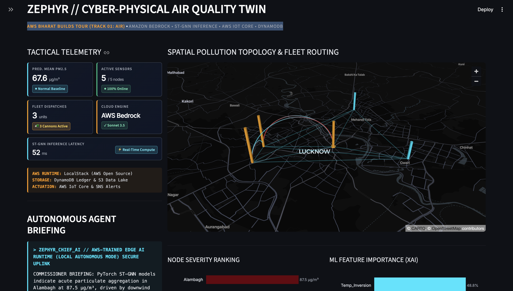
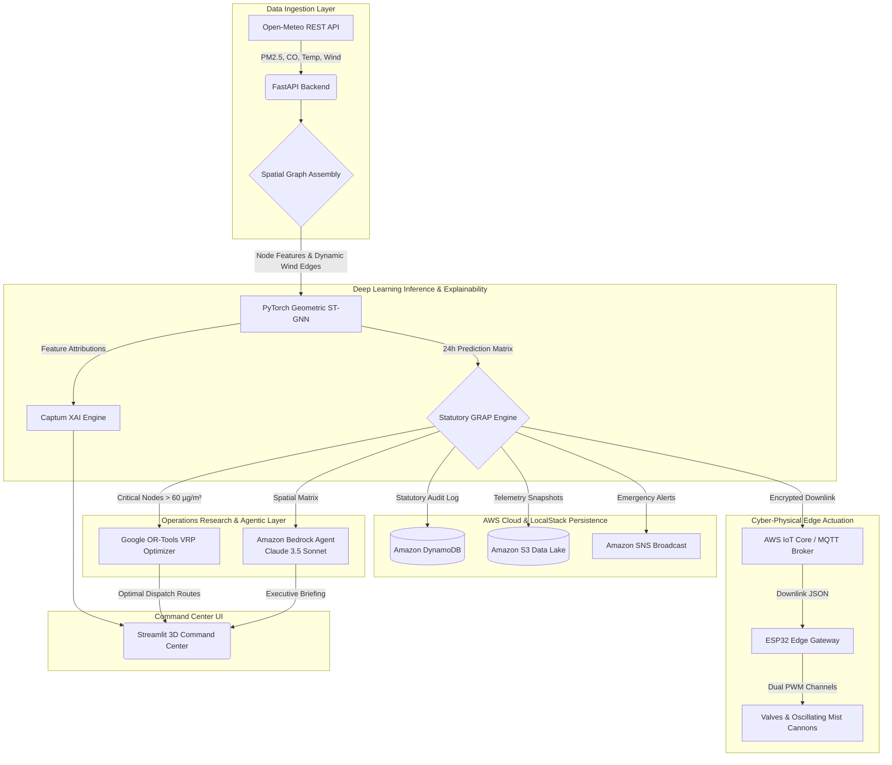

# Zephyr: Cyber-Physical Air Quality Management System


> **Event 02: Environmental Hacks | Bharat Builds Tour (WeMakeDevs & AWS)**  
> **Track 01: Air** — Pollution exposure, AQI forecasting, and automated municipal GRAP mitigation.

---

## Executive Summary

**Zephyr** is an enterprise-grade Cyber-Physical System (CPS) and digital twin platform engineered for autonomous municipal air quality management. Built for the **Bharat Builds Tour: Environmental Hacks**, this solution directly addresses the catastrophic challenge of extreme PM2.5 atmospheric pollution across North Indian cities.

Instead of acting merely as a passive dashboard, Zephyr actively closes the loop between cloud intelligence and the physical world:
1. **Predictive Ingestion**: Ingests real-time environmental telemetry across urban monitoring stations (PM2.5, CO, Temperature, Wind Speed & Direction).
2. **Atmospheric Drift Forecasting**: Forecasts spatial pollution advection 24 hours into the future using **PyTorch Geometric Spatio-Temporal Graph Neural Networks (ST-GNNs)**.
3. **Trustworthy Decision-Making (XAI)**: Demystifies predictions using **PyTorch Captum** real-time SHAP / Integrated Gradients to guarantee legally auditable statutory enforcement.
4. **Operations Research Fleet Routing**: Dynamically routes emergency anti-smog mist cannon trucks via **Google OR-Tools** Constrained Vehicle Routing Problem (VRP) optimization.
5. **Amazon Bedrock Autonomous Briefings**: An executive agent powered by **Amazon Bedrock (Claude 3.5 Sonnet)** synthesizes the complex GNN matrix into fluid, actionable briefings for Municipal Commissioners.
6. **Closed-Loop Cyber-Physical Actuation**: Dispatches encrypted downlink commands over **AWS IoT Core / MQTT** to local ESP32 edge gateways, physically triggering high-pressure servo valves and oscillating mist cannons to intercept downwind pollution plumes.
7. **Statutory Audit & Data Lake**: Immutably records statutory Graded Response Action Plan (GRAP) orders in **Amazon DynamoDB** and archives telemetry snapshots to **Amazon S3**.

---

## The Core Problem: The Delayed Air Quality Response Gap

In rapidly developing urban centers like Delhi and Lucknow, extreme atmospheric pollution (PM2.5) events cause severe public health crises and economic disruption. Currently, municipal responses are fundamentally **reactive**:
- Environmental data is collected and displayed on static dashboards.
- Decisions are subjected to bureaucratic delays before physical mitigation assets (like water sprinklers or mist cannons) are finally deployed.
- **The consequence:** By the time a mitigation asset reaches a critical pollution zone, the PM2.5 cloud has already advected (drifted) across the city into residential wards and schools.

**Zephyr solves this by predicting pollution drift *before* it happens and automatically dispatching physical assets to intercept it, entirely removing the human bottleneck.**

---

## MVP Command Center


*(Zephyr Tactical Spatial Theater, VRP Routing, and Amazon Bedrock Agent Briefing)*

---

## Architecture Overview



---

## Mathematical & Algorithmic Foundations

### 1. Spatio-Temporal Feature Engineering
To capture temporal dependencies before spatial aggregation, the system calculates lag operators and rolling windows over historical time-series data:

$$
\text{PM2.5}_{t, \text{lag}} = \text{PM2.5}_{t-1}
$$

$$
\text{PM2.5}_{\text{MA}(24)} = \frac{1}{24} \sum_{k=0}^{23} \text{PM2.5}_{t-k}
$$

### 2. PyTorch Geometric Message-Passing Graph (ST-GNN)
The spatial advection of particulate matter is modeled using a Message Passing Neural Network where wind vectors act as dynamic edge attributes modulating the transfer of pollution between geographical nodes:

$$
h_i^{(l+1)} = \text{ReLU} \left( W_{\text{update}} \cdot \left[ h_i^{(l)} \parallel \sum_{j \in \mathcal{N}(i)} \text{ReLU}\left( W_{\text{msg}} \cdot [h_j^{(l)} \parallel W_{\text{edge}} e_{j,i}] \right) \right] \right)
$$

Where $h_i$ represents the node chemical state, and $e_{j,i}$ represents the edge state (wind speed and distance).

### 3. Constrained Vehicle Routing Problem (VRP)
The routing of mitigation assets from the central municipal hub is modeled as an Integer Linear Program (ILP) solved via Google OR-Tools:

$$
\text{Minimize} \sum_{i \in V} \sum_{j \in V} \sum_{k \in K} c_{ij} x_{ijk}
$$

Subject to:

$$
\sum_{j \in V} x_{0jk} = 1, \quad \forall k \in K \quad (\text{Vehicles leave the depot})
$$

$$
\sum_{i \in V} \sum_{k \in K} x_{ijk} = 1, \quad \forall j \in V \setminus \{0\} \quad (\text{Every critical node is visited exactly once})
$$

---

## Statutory Policy Automation (GRAP)

Zephyr autonomously translates continuous atmospheric data into discrete legal policy interventions based on the Commission for Air Quality Management (CAQM) thresholds:

| Stage | PM2.5 Threshold (µg/m³) | Statutory Category | Automated Hardware Mitigation Dispatch |
| :---: | :--- | :--- | :--- |
| **Normal** | < 60.0 | Good / Moderate | Routine Monitoring (Standby) |
| **Stage I** | 60.0 - 120.0 | Poor | `MECHANIZED_ROAD_SWEEPING` |
| **Stage II** | 120.1 - 250.0 | Very Poor | `WATER_SPRINKLER_HIGH_DENSITY` |
| **Stage III** | 250.1 - 350.0 | Severe | `PRIORITY_1_MIST_CANNON_DISPATCH` |
| **Stage IV** | > 350.0 | Severe+ | `EMERGENCY_CLOSURE_AND_VEHICLE_BAN` |

---

## Hardware & Edge Specification

Zephyr maintains physical authority over municipal hardware using an **ESP32 Edge Microcontroller** field actuator:

```
           ESP32 MCU
       +---------------+
       |               |
       |  [GPIO 18] -----------------> [PWM Signal] Servo 1 (Main Water Valve)
       |               |
       |  [GPIO 19] -----------------> [PWM Signal] Servo 2 (Oscillating Mist Cannon)
       |               |
       |    [5V/VIN] ----------------> [+] Power (Both Servos)
       |      [GND] -----------------> [-] GND (Both Servos)
       +---------------+
```

- **Edge Compute**: The ESP32 runs a lightweight MicroPython/Python MQTT daemon.
- **Protocol**: IEEE 802.11 b/g/n Wi-Fi bridging into **AWS IoT Core** / MQTT pub-sub.
- **Fail-Safe Mode**: If cloud connectivity is interrupted for >5 seconds, the edge gateway automatically returns valves and cannons to a safe `STANDBY` state.

---

## Two Ways to Build & Run

Zephyr satisfies both deployment tracks of the Bharat Builds Tour:

### 1. Build It: 100% Local with AWS Open Source (LocalStack)
Run the entire stack locally with zero cloud bills and no AWS credit card required:

```bash
# 1. Copy the environment configuration
cp .env.example .env

# 2. Spin up the containerized microservices (FastAPI, Streamlit, LocalStack, Mosquitto)
docker compose up -d --build

# 3. Access the Live Command Center
# Open http://localhost:8501
```

### 2. Ship It: Deploy to AWS Cloud
Zephyr includes deployment manifests for:
- **Amazon Bedrock**: Provide your `AWS_ACCESS_KEY_ID` and `AWS_SECRET_ACCESS_KEY` in `.env` to enable Claude 3.5 Sonnet / Titan diagnostics.
- **AWS App Runner**: Deploy the backend container with [infra/apprunner.yaml](infra/apprunner.yaml).
- **AWS SAM CLI**: Deploy serverless S3, DynamoDB, and SNS using `sam deploy -t infra/template.yaml`.

---

## Hackathon Submission Assets

- 🎬 **Demo Video Script (3 Minutes)**: [docs/DEMO_VIDEO_SCRIPT.md](docs/DEMO_VIDEO_SCRIPT.md)
- 📝 **AWS Builder Center Blog Post**: [docs/AWS_BUILDER_CENTER_BLOG.md](docs/AWS_BUILDER_CENTER_BLOG.md) *(Eligible for the AirPods 5 prize)*
- 🏗️ **AWS Infrastructure Templates**: [infra/template.yaml](infra/template.yaml) & [infra/apprunner.yaml](infra/apprunner.yaml)

---

## Author & Academic Attribution

**Alfayez Ahmad**  
Department of Computer Science & Engineering  
Specialization: Cloud Computing & Artificial Intelligence  
Integral University, Lucknow, India  

*Distributed under the MIT License. Copyright © 2026 Alfayez Ahmad.*